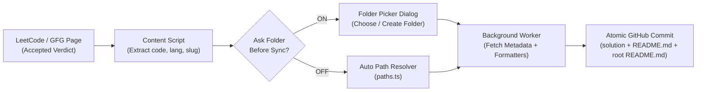

# CodeSync — Coding Solutions to GitHub

**CodeSync** is a Manifest V3 Chrome Extension and companion Next.js platform that automatically synchronizes verified `Accepted` solutions from **LeetCode** and **GeeksforGeeks** directly to your GitHub repository in clean, single atomic commits.

---

## Key Features

- **Strict Accepted-Only Gate**: Non-accepted verdicts (`Wrong Answer`, `TLE`, `MLE`, `Runtime Error`, `Compile Error`) are filtered out at interception time and never pushed to GitHub.
- **Single Atomic Commits**: Uses GitHub's Git Data API (`Blobs` -> `Tree` -> `Commit` -> `Ref Update`) to push both your formatted solution file and generated `README.md` in one clean commit.
- **Rich Problem `README.md`**: Automatically converts LeetCode HTML descriptions into GitHub-flavored Markdown with difficulty shields, topic tags, and runtime/memory percentile benchmarks.
- **Syntax-Aware Solution Headers**: Prepends metadata comment blocks (`#` for Python/Ruby, `--` for SQL, `/* ... */` for C++/Java/JS/TS/Go/Rust) with de-duplication on re-sync.
- **Interactive Repository & Branch Management**: Browse repositories, verify write access, select target branches, or create a brand-new repository directly inside the extension.
- **Overwrite & Deduplication Policies**: Choose between `Always Overwrite`, `Overwrite Only if Improved` (compares runtime), or `Never Overwrite`.
- **Audit Log & Retry Engine**: Inspect past syncs, view failure diagnostics, export logs to JSON, and retry failed commits with one click.

---

## Monorepo Architecture

```
├── apps/
│   ├── extension/     # Chrome Extension (Manifest V3, React 19, Vite, CRXJS, Tailwind v4)
│   └── web/           # Companion Next.js 16 Platform & Better Auth GitHub OAuth Exchange
└── packages/
    └── shared/        # Shared TypeScript models, language mappings, & code/README formatters
```

---

## Sync Architecture & Repository Structure

### End-to-End Flow



### Target Repository Folder Layouts

Configure your preferred layout in **Settings → Preferences → Folder Organization**:

1. **By Platform (`platform` — Default)** — Separates LeetCode and GeeksforGeeks cleanly:
   ```text
   your-dsa-repo/
   ├── README.md                          # Auto-updated progress table (all platforms)
   ├── leetcode/
   │   ├── 0001-two-sum/
   │   │   ├── two-sum.java               # or solution.java / 0001-two-sum.java
   │   │   └── README.md                  # Problem statement, difficulty badge, stats
   │   └── 0198-house-robber/
   │       ├── house-robber.py
   │       └── README.md
   └── gfg/
       ├── second-largest/
       │   ├── second-largest.java
       │   └── README.md
       └── kadanes-algorithm/
           ├── kadanes-algorithm.cpp
           └── README.md
   ```

2. **By Platform + Topic (`platform-topic`)** — Separates by platform and primary DSA tag:
   ```text
   your-dsa-repo/
   ├── README.md
   ├── leetcode/
   │   ├── dynamic-programming/0198-house-robber/
   │   ├── sql/0175-combine-two-tables/
   │   └── array/0001-two-sum/
   └── gfg/
       ├── array/second-largest/
       └── dynamic-programming/knapsack/
   ```

3. **By Platform + Difficulty (`platform-difficulty`)**:
   ```text
   your-dsa-repo/
   ├── README.md
   ├── leetcode/easy/0001-two-sum/
   └── gfg/medium/kadanes-algorithm/
   ```

4. **Other Modes**:
   - **By Topic (`topic`)**: `dynamic-programming/0198-house-robber/`, `sql/0175-combine-two-tables/`
   - **By Difficulty (`difficulty`)**: `easy/0001-two-sum/`, `medium/...`, `hard/...`
   - **By Language (`language`)**: `java/0001-two-sum/`, `python3/...`, `sql/...`
   - **Flat (`flat`)**: `0001-two-sum/` directly in the repository root
   - **Ask Folder Before Sync (`askFolderBeforeSync`)**: Overrides the auto-category per submission so you can place solutions into custom sheet folders (e.g., `striver-sde-sheet/arrays/0001-two-sum/`)

### Generated Files per Submission
- **Solution File** (`<slug>.<ext>`, `solution.<ext>`, or `<id>-<slug>.<ext>`): Includes a syntax-aware header comment with title, link, difficulty, runtime, and memory.
- **Problem `README.md`**: Problem title, difficulty badge, topic tags, and formatted problem statement.
- **Root `README.md`**: Auto-updated summary table tracking **Platform**, **Problem**, **Difficulty**, **Language**, and **Runtime/Memory** across all synced solutions.

---

## Local Development

### Prerequisites
- **Node.js** 20+
- **pnpm** 10+

### 1. Install Dependencies
```bash
pnpm install
```

### 2. Configure Environment Variables
- **`apps/web/.env.local`**:
  ```env
  GITHUB_CLIENT_ID=your_github_oauth_client_id
  GITHUB_CLIENT_SECRET=your_github_oauth_client_secret
  BETTER_AUTH_SECRET=your_random_32_byte_secret
  BETTER_AUTH_URL=http://localhost:3000
  ```
- **`apps/extension/.env.local`**:
  ```env
  VITE_GITHUB_CLIENT_ID=your_github_oauth_client_id
  VITE_BACKEND_URL=http://localhost:3000
  ```

### 3. Build & Test
```bash
# Run all unit tests
pnpm run test

# Typecheck across the entire monorepo
pnpm run typecheck

# Build Chrome Extension into apps/extension/dist
pnpm --filter @leetsync/extension build

# Package Chrome Web Store zip (apps/extension/codesync-extension.zip)
pnpm --filter @leetsync/extension package:zip
```

### 4. Load in Chrome
1. Open `chrome://extensions` in Chrome.
2. Enable **Developer mode** (top right).
3. Click **Load unpacked** and select `apps/extension/dist`.

---

## Deploying the OAuth Backend (`apps/web`) to Production

To allow users to sign in with GitHub without running a local server:

1. **Deploy `apps/web` to Vercel**:
   - Set **Root Directory** to `apps/web`.
   - Set **Build Command** to `pnpm --filter web build` (or run from monorepo root).
   - Add Environment Variables in Vercel:
     - `GITHUB_CLIENT_ID`
     - `GITHUB_CLIENT_SECRET`
     - `BETTER_AUTH_SECRET`
     - `BETTER_AUTH_URL` = `https://<your-vercel-domain>`
2. **Update GitHub OAuth App**:
   - In GitHub Developer Settings $\rightarrow$ OAuth Apps, set **Authorization callback URL** to:
     `https://<your-vercel-domain>/api/auth/callback/github`
3. **Build Extension for Production**:
   - Update `apps/extension/.env.local` with `VITE_BACKEND_URL=https://<your-vercel-domain>`.
   - Run `pnpm --filter @leetsync/extension package:zip`.

---

## Privacy

CodeSync stores all GitHub access tokens, repository selections, and sync logs strictly on your local device via `chrome.storage.local`. See [PRIVACY.md](./PRIVACY.md) for full details.
